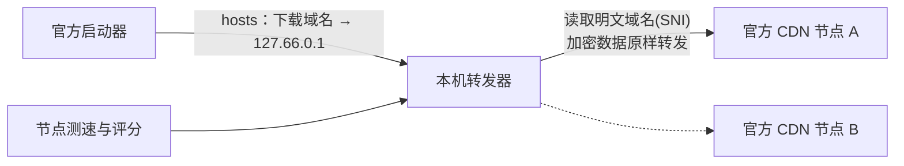

# mhyAccelerator

**米哈游国服启动器下载加速器** · 让海外玩家用官方启动器下载国服游戏时跑得更快。

[English](#english) · [下载与使用](#下载与使用) · [工作原理](#工作原理) · [常见问题](#常见问题) · [从源码构建](#从源码构建)

> 非官方工具，与米哈游 / HoYoverse 无任何关联。

---

## 它解决什么问题

在中国大陆以外用国服启动器下载《原神》《崩坏：星穹铁道》《绝区零》《崩坏3》时，速度常常只有几 MB/s。原因不是你的带宽不够，而是启动器分配到的 CDN 节点对海外线路很不友好：同一个下载域名背后有上百个节点，快慢能差几十倍，而启动器分到哪个就一直用哪个。

mhyAccelerator 在后台为启动器挑选并持续切换到更快的官方节点。**你照常使用官方启动器下载**，它只负责让连接走更快的路。

## 特点

- **不改启动器、不改游戏文件**：只调整网络连接去往哪个官方节点，下载、校验、安装全部由官方启动器完成。
- **不解密流量、不装证书、不装驱动**：只读取连接中明文的目标域名，加密数据原样转发，证书仍由启动器自己校验。
- **只碰四个下载域名**：其他任何流量都不经过本工具。
- **真实测速选节点**：直接下载启动器真正使用的分块文件，按启动器的连接方式测速，并识别"起速快、随后限速"的节点。
- **下载中持续优化**：节点断流或骤降时先切换，再在后台复测，确认有问题才降级；能区分是节点的问题还是本机网络的问题。
- **记住好节点**：每次的实测结果保存在本地，下次启动直接用上。
- **绝不留下烂摊子**：停止加速、关闭窗口、程序崩溃、甚至断电，hosts 都会被自动还原（详见[安全机制](#安全机制)）。
- **图形界面和命令行两个版本**，都支持中文和英文。

## 实测效果

以下是作者所在网络下的实测（海外，约 500 Mbps 宽带）。加速效果取决于你所在的地区和运营商，仅供参考。

| 游戏 | 不加速 | 加速后 |
|---|---|---|
| 崩坏：星穹铁道 | 约 31 MB/s | 63–65 MB/s |
| 绝区零 | 稳定后 3–4 MB/s | 33–46 MB/s |
| 原神 | 基准估算约 10 MB/s | 约 62 MB/s |

## 下载与使用

### 运行环境

- Windows 10 / 11（64 位）
- 管理员权限（需要修改 hosts 文件，启动时会弹出 Windows 的权限确认）
- 图形界面版需要 WebView2（Windows 11 自带，Windows 10 绝大多数已安装）

### 图形界面版（推荐）

1. 从 [Releases](../../releases) 下载 `mhyacc-gui.exe`。
2. 双击运行，在权限确认弹窗中点"是"。
3. 勾选要加速的游戏，点 **开始加速**。
4. 如果米哈游启动器正开着，会弹窗提示你先**暂停下载并完全退出启动器**（包括托盘图标）。启动器会记住旧节点，不退出的话加速不会生效。
5. 看到 **加速中** 后，打开启动器照常下载。
6. 下载完成后点 **停止加速** 或直接关闭窗口，hosts 会自动还原。

界面会实时显示当前速度、比基准速度快多少、已加速流量、每个游戏使用的协议和节点，以及节点测速、切换、复测的完整事件记录。

### 命令行版

双击 `mhyacc.exe` 进入交互模式：

```
  请选择语言 / Select language
    1  中文 ◀
    2  English
  > 1

  选择要加速的游戏
    [x] 1  原神
    [ ] 2  崩坏：星穹铁道
    [ ] 3  绝区零
    [ ] 4  崩坏3
  输入序号切换选择（可输入多个，如 1 3），直接回车开始加速：

✓ 加速已开启，现在可以打开启动器下载
  停止加速：关闭本窗口或按 Ctrl+C（hosts 会自动还原）

── 事件记录 ──
21:17:09  原神：基准速度（估算）5.5 MB/s
21:17:37  原神：采用 HTTP/2 节点，首选 138.113.48.244（预计 23.8 MB/s）
 ● 加速中  │  速度 62.4 MB/s  │  比基准快 +56.9 MB/s  │  已加速 7.47 GB  │  运行 12:03
```

也可以带参数直接运行，适合写脚本：

```
mhyacc run   -game hk4e_cn,nap_cn [-lang en]   开始加速（游戏：hk4e_cn 原神, hkrpg_cn 星穹铁道, nap_cn 绝区零, bh3_cn 崩坏3, all 全部）
mhyacc probe -game all                         只测速，不改动系统，不需要管理员权限
mhyacc status                                  查看 hosts 接管状态和保护措施
mhyacc off                                     手动还原 hosts（一般用不到）
```

## 工作原理



1. **发现节点**：模拟中国大陆各运营商、港日新美德等多个地区查询下载域名，通常能找到数十到上百个官方节点。
2. **测速**：先短测筛选，再对入围节点用启动器同样的方式（真实分块文件、相同的连接数）长测，排除只是"起速快"的节点。
3. **接管**：在 hosts 中把四个下载域名指向本机专用回环地址 `127.66.0.1`，并清除启动器自己缓存的旧节点。
4. **转发**：启动器的每条连接到达本机后，只读取 TLS 握手中明文的目标域名，确认是游戏下载域名后，把加密数据原样转发给选中的节点。
5. **持续优化**：每秒统计每条连接的速度。断流或骤降时先切换节点，再在后台复测原节点；复测正常就恢复，确认异常才降级。

**关于 HTTP/1.1 与 HTTP/2**：启动器连到 HTTP/2 节点时，会把所有下载合并到一条连接上；连到 HTTP/1.1 节点时，会开 12 条并行连接，跨境线路上往往更快。本工具会测量两种方式的实际速度，自动选择更合适的一种。原神和绝区零目前只有 HTTP/2 节点，提速完全来自挑选更快的节点。

更详细的设计与实测记录见 [docs/DESIGN.md](docs/DESIGN.md)。

## 安全机制

hosts 被接管期间如果程序没能还原，启动器会连不上下载服务器。为此有三层保护：

| 情况 | 由谁还原 |
|---|---|
| 正常停止、关闭窗口、Ctrl+C | 程序自己 |
| 程序崩溃或被强制结束 | 启动时随之开启的看门狗进程，约 0.5 秒内还原 |
| 断电、蓝屏 | 加速期间登记的 Windows 开机任务，下次开机时还原后自行删除 |

hosts 中由本工具写入的内容带有明确的起止标记，还原时只删除这一段，不影响你自己的 hosts 条目。万一需要手动处理，可以在图形界面点 **立即还原 hosts**，或运行 `mhyacc off`。

## 常见问题

**会被封号吗？**
本工具不修改、不注入启动器和游戏，不读取或篡改任何游戏数据，不使用驱动，只改变下载连接去往哪个官方节点，下载的仍是官方 CDN 上的官方文件。但我们无法代表米哈游作出任何保证，请自行判断并遵守游戏的用户协议。

**为什么要先退出启动器？**
启动器会把查到的节点地址缓存下来，重启后继续使用。只有在它退出时清掉这份缓存，接管才会生效。

**加速后反而变慢 / 不稳定？**
节点状况随时间变化。程序会自动切换节点，事件记录里能看到原因。如果持续不理想，可以停止加速后重新开始，让程序重新测速。

**原神、绝区零为什么提速有限？**
这两个游戏的节点只支持 HTTP/2，启动器只用一条连接下载，速度取决于这一条连接能跑多快。程序会选出单连接最快的节点，但无法像星穹铁道那样开多条连接。

**数据存在哪里？**
节点记录、设置和事件日志保存在 `%LOCALAPPDATA%\mhyAccelerator`，可以在图形界面中一键清除。本工具不上传任何数据。

## 已知限制

- 仅支持 Windows。
- 最多约四分之一的下载流量可能走启动器自带的 PCDN，这部分不经过本工具。
- 基准速度（"比原速度快多少"）是估算值：启动器使用自带的 DNS 服务分配节点，本工具只能近似模拟。
- 启动器日志格式或下载域名变化后，部分功能可能需要更新。

## 从源码构建

需要 [Go](https://go.dev/dl/) 1.22 或更高版本。

```
go build -o bin/mhyacc.exe ./cmd/mhyacc
go build -tags desktop,production -ldflags "-H windowsgui -s -w" -o bin/mhyacc-gui.exe ./cmd/mhyacc-gui
go test ./...
```

图形界面基于 [Wails](https://wails.io)，前端是纯 HTML/CSS/JS，无需 Node.js。

### 目录结构

```
cmd/mhyacc/          命令行版
cmd/mhyacc-gui/      图形界面版（Wails）
internal/engine/     加速引擎：发现、测速、接管、优化、还原
internal/forwarder/  本机转发器（读取 SNI，原样转发）
internal/nodetable/  节点评分与选择
internal/probe/      测速
internal/resolver/   多地区节点发现
internal/sophon/     读取启动器的分块下载清单
internal/launcher/   读取启动器状态与日志
internal/guard/      看门狗与开机清理任务
internal/sysconf/    hosts 接管与还原
internal/memory/     节点历史记录
docs/DESIGN.md       设计文档与实测记录
```

## 许可证与声明

代码以 [MIT](LICENSE) 许可证开源。

"原神""崩坏：星穹铁道""绝区零""崩坏3"及相关名称和标识归其各自权利人所有。本项目为非官方工具，与米哈游 / HoYoverse 无任何关联，不托管、不分发任何游戏文件。使用本工具的风险由使用者自行承担。如权利人认为本项目存在不妥，请通过 Issue 联系，我们会积极配合调整。

---

## English

**mhyAccelerator** speeds up downloads in the official **miHoYo CN-server launcher** (Genshin Impact, Honkai: Star Rail, Zenless Zone Zero, Honkai Impact 3rd) for players outside mainland China.

Outside China the launcher often crawls at a few MB/s: each download host is served by a hundred or more CDN nodes whose speed abroad differs enormously, and the launcher sticks to whichever it was given. mhyAccelerator picks faster official nodes and keeps switching as conditions change, **while you keep downloading with the official launcher as usual**.

- **No changes to the launcher or game files**; no decryption, no certificates, no drivers. Only the plaintext SNI of each connection is read; encrypted bytes are relayed unchanged and the launcher still verifies the real certificate.
- **Only four download hosts** are touched.
- **Realistic speed tests** on the launcher's own chunk files, the way the launcher downloads them; nodes that start fast and then throttle are detected.
- **Switch first, judge later**: on a stall or collapse the connection moves to another node at once; the old node is re-tested in the background and only demoted if it really fails.
- **Always cleans up**: hosts is restored on stop, window close, crash (watchdog) or power loss (boot task).
- **GUI and console versions**, both in Chinese and English.

**Usage**: download `mhyacc-gui.exe` from [Releases](../../releases), run it (it asks for administrator rights to edit the hosts file), select games, press **Start**, quit the launcher if asked, then reopen the launcher and download. Press **Stop** or close the window when done. The console version `mhyacc.exe` offers the same flow interactively, or `mhyacc run -game all -lang en` for scripts.

**Requirements**: Windows 10/11 64-bit, administrator rights, WebView2 for the GUI.

**Build**: Go 1.22+, see [From source](#从源码构建).

Unofficial; not affiliated with miHoYo / HoYoverse. All game names and marks belong to their owners. No game files are hosted or distributed. Use at your own risk. Licensed under [MIT](LICENSE).
