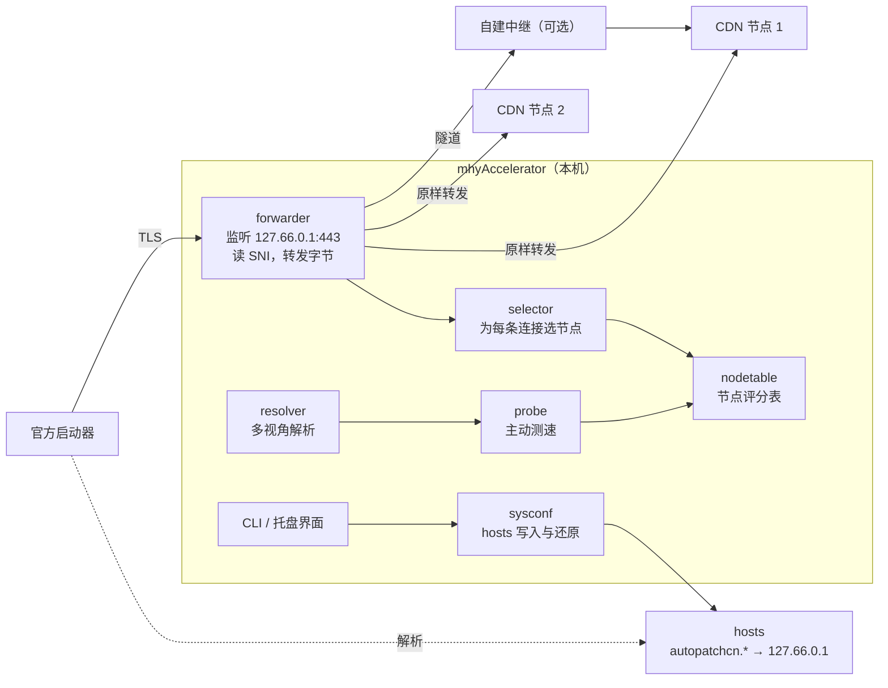

# mhyAccelerator 设计与实现文档

> 状态：草案 v0.2（2026-11-12）
> 一个面向海外用户的米哈游国服游戏下载加速工具。非官方项目，与米哈游无任何关联。
>
> v0.2 变更：产品形态从"独立下载器"改为"给官方启动器加速"。下载、校验、安装全部仍由官方启动器完成，本工具只优化它的网络路径。
>
> v0.3 变更：M0.5 初测时 hosts 没生效，一度考虑改用 WinDivert 驱动。
>
> v0.4 变更：查明原因是启动器持久化的 DNS 缓存，清缓存后 hosts 方案成立，不需要驱动，第 3 到 5 节的 hosts 设计继续有效。新增约束：只把启动器引到 HTTP/1.1 节点（见第 8 节 M1 实测）。

## 1. 背景与目标

### 1.1 问题

在中国大陆以外用官方启动器下载国服客户端（原神、崩坏：星穹铁道、绝区零、崩坏3）时速度很慢。原因：

1. **CDN 调度不了解海外用户**。国服资源域名在海外解析到的节点，往往不是对该用户最快的节点。同一个域名下，不同节点的速度可以差一个数量级（见第 8 节实测）。
2. **跨境链路丢包高**。单条 TCP 连接的拥塞窗口在丢包下起不来。
3. **启动器不会换节点**。它只用系统 DNS 给的那几个 IP，慢了也不会切换。

### 1.2 目标

- 用户照常使用官方启动器，点"下载"或"更新"。本工具在后台运行，启动器的下载速度变快。
- 不改动启动器和游戏的任何文件。
- 默认模式下不解密任何流量，不安装证书。
- 单个可执行文件，开关一键，关闭后系统恢复原状。

### 1.3 非目标

- 不加速游戏内联机延迟。
- 不替代官方启动器，不自己下载或安装游戏。
- 不托管、不缓存到公网、不再分发任何游戏文件。
- 不做通用代理，只处理白名单内的米哈游资源域名。

## 2. 已确认的事实（2026-11-12 实测）

- 四个游戏的当前版本都通过 **Sophon 分块下载**分发。`getGameBranches` 加 `getBuild` 返回的版本是原神 7.2.0、星穹铁道 4.7.0、绝区零 3.3.0、崩坏3 9.1.0。
- 旧的压缩包接口 `getGamePackages` 仍然能访问，但四个游戏的版本都已落后，不能作为依据。
- 分块和清单都走 **HTTPS**，域名是 `autopatchcn.yuanshen.com`、`autopatchcn.bhsr.com`、`autopatchcn.juequling.com`、`autopatchcn.bh3.com`。
- 分块很小，平均约 1 MB（星穹铁道本体：96,071 个分块，共 103 GB）。

推论：启动器的下载是"大量小文件的 HTTPS 请求"。对单个分块做 Range 多连接切分没有意义，总速度约等于**启动器自身的并发数 × 每条连接的速度**。我们能动的是后一项，以及让这些连接分散到多个好节点上。

## 3. 方案选型

| 方案 | 做法 | 是否解密流量 | 效果 | 结论 |
|---|---|---|---|---|
| A. 静态 hosts 优选 | 测速后把最快的 IP 写进 hosts | 否 | 中。只能固定一个 IP，节点变慢或失效时启动器直接卡住 | 作为最简降级模式 |
| **B. 本地透明转发** | hosts 把资源域名指向本机回环地址，本机程序按 SNI 把每条连接原样转发到当前最快的节点 | 否 | 高。多节点分流、实时评分、失败自动换节点 | **默认模式** |
| C. 经自建中继转发 | 在 B 的基础上，把连接经隧道送到用户自己的 VPS 再出去 | 否，TLS 仍是启动器到 CDN 端到端 | 高，线路好时最稳 | 可选 |
| D. 本地缓存预取 | 本机解密启动器流量，自己解析清单并以高并发提前拉取分块，启动器请求时本地直接返回 | **是**，需安装本机根证书 | 最高，不受启动器并发数限制 | 实验性，默认关闭 |
| E. P2P 或公共镜像 | 用户互传或项目方托管 | 无关 | 高 | **不做**，属于再分发游戏文件 |

方案 B 的关键点：转发发生在 TCP 层，本工具只读取 TLS 握手里明文的域名（SNI）来判断该不该转发，之后原样搬运字节。证书校验仍然由启动器对真正的 CDN 完成，本工具既看不到也改不了内容。

方案 D 只在 B 的效果被启动器并发数卡住时才有必要，而且前提是启动器不做证书固定，这点尚未验证。

## 4. 总体架构



一条连接的生命周期：

1. 启动器解析 `autopatchcn.bhsr.com`，hosts 返回 `127.66.0.1`。
2. 启动器连到本机的 `forwarder`，发出 TLS ClientHello。
3. `forwarder` 读出 SNI，确认在白名单内，向 `selector` 要一个节点。
4. `forwarder` 连上该节点，把 ClientHello 原样发过去，之后双向搬运字节，同时统计这条连接的吞吐。
5. 连接结束后，统计结果回写 `nodetable`，影响后续选择。

## 5. 模块设计

### 5.1 sysconf：系统接管与还原

- 在 hosts 中写入一个带起止标记的区块，把四个资源域名指向 `127.66.0.1`。用专用回环地址而不是 `127.0.0.1`，避免和本机其他占用 443 端口的程序冲突。
- 写入后刷新 DNS 缓存。
- **还原是第一优先级**。本工具异常退出而 hosts 没还原，启动器会完全无法下载。对策：
  - 正常退出、收到关机信号时还原。
  - 启动时发现残留区块而转发器没在运行，先清掉。
  - 提供独立的 `mhyacc off` 命令，不依赖主进程。
  - 看门狗进程：`run` 启动一个脱离控制台的 `mhyacc watchdog -pid <主进程>`，主进程被强制结束或崩溃时，由它清理 hosts。hosts 区块里记录了所属进程号，看门狗只清理属于自己主进程的区块。
  - 开机清理任务：`run` 期间登记一个以 SYSTEM 身份在开机时运行 `mhyacc off -boot` 的计划任务，应对断电和蓝屏；正常退出时删除。
  - 还原时一并清掉启动器的 DNS 缓存，避免启动器继续使用缓存里的本机地址。
  - （以上已在 `internal/guard` 中实现。）
- 修改 hosts 需要管理员权限，只在开关时请求一次。
- 后续可增加基于 WinDivert 或 WFP 的重定向，作为不改 hosts 的替代方案。

### 5.2 forwarder：SNI 转发器

- 监听 `127.66.0.1:443`。
- 读取首个 TLS 记录，解析 ClientHello 中的 SNI。带超时和长度上限。
- SNI 不在白名单内，或不是 TLS，直接断开。本工具永远不会成为开放代理。
- 向上游节点拨号时用真实解析器得到的 IP，绝不能再走系统解析，否则会连回自己。
- **透明重拨**：上游连接失败，或在返回任何字节之前就断开时，换一个节点重放 ClientHello。启动器对此无感知。
- 双向拷贝使用较大的缓冲区，开启 TCP keepalive。
- 可选监听 80 端口做同样的事（按 Host 头转发），以防启动器有明文请求。

### 5.3 resolver：多视角解析

- 用多个 DoH 服务解析资源域名，并带上不同地区的 EDNS Client Subnet（大陆三大运营商、香港、日本、新加坡、美国、欧洲），诱导 CDN 的调度返回不同地区的节点。
- 加上系统 DNS 的原始结果（接管前取得）。
- 定期刷新，结果落盘缓存。

实测一个域名可以这样收集到约 90 个节点 IP。

### 5.4 probe：主动测速

- 对候选 IP 做 TCP 加 TLS 握手（校验证书），失败的淘汰。
- 对一个真实的分块 URL 做限时下载，记录吞吐。测试用的 URL 从 `getBuild` 接口和清单得到，或直接用 `getGamePackages` 里仍可访问的旧压缩包做 Range 请求。
- 启动时测一轮，之后低频复测，流量消耗要有上限。

### 5.5 nodetable 与 selector：评分与选择

- 每个节点的分数来自两部分：`probe` 的主动测速，以及真实转发连接的被动统计（吞吐、连接失败率、中途断开率）。被动统计的权重随样本增多而上升。
- 选择策略是在排名靠前的若干节点里**加权随机**，而不是永远选第一名。这样启动器的并发连接会分散到多个节点，既不把单个节点压到限速，也能持续获得其他节点的样本。
- 单节点同时连接数有上限。
- 连续失败的节点进入冷却期。
- 按域名分别维护，四个游戏的 CDN 互不相同。

### 5.6 relay：自建中继（可选）

- 服务端是一个受限的 TCP 隧道：客户端声明目标域名，服务端校验白名单后连到 CDN，双向搬运字节。
- TLS 仍然是启动器与 CDN 之间端到端的，中继看不到内容，用户不需要信任中继的运营者。
- 令牌鉴权、并发上限、流量配额。提供 Docker 镜像，文档说明开启 BBR。
- 在客户端，中继就是 `nodetable` 里的一类特殊节点，和直连节点一起参与评分。
- 项目本身不运营公共中继。

### 5.7 prefetch：本地缓存预取（实验性）

仅当 5.2 的效果被启动器并发数限制时才做。

- 本机生成一个根证书，私钥不出本机，证书带名称约束，只能签发四个资源域名。卸载或关闭该模式时删除。
- 本机终止 TLS，看到启动器请求清单后，自己解析清单（zstd 压缩的 protobuf），以高并发从多个节点预取分块到本地临时缓存。
- 启动器请求分块时从缓存直接返回，未命中则实时回源。
- 缓存只在本机，下载完成后清空。
- 明确告知用户这个模式的安全含义，默认关闭。

### 5.8 配置与远程规则

- 本地配置：开关状态、中继列表、每节点连接上限、测速流量上限。
- 远程规则：放在本仓库，包含资源域名白名单、接口地址、DoH 服务列表。带版本号和签名，拉取失败用内置副本。米哈游更换域名时不必发版。

## 6. 技术选型

- **语言：Go**。标准库就能完成 SNI 解析和高并发转发，交叉编译成单文件，客户端和中继共用代码。
- **CLI**：`cobra`。
- **界面**：先做系统托盘（开关、当前速度、节点表），用 `Wails` 或 `systray`。
- **依赖**：`miekg/dns`（DoH 与 ECS）。预取模式另需 `klauspost/compress` 和 `google.golang.org/protobuf`。
- **平台**：Windows。

## 7. 仓库结构与命令

```
mhyAccelerator/
├─ cmd/
│  ├─ mhyacc/            # 客户端
│  └─ mhyacc-relay/      # 中继服务端
├─ internal/
│  ├─ sysconf/           # hosts 接管与还原
│  ├─ forwarder/         # SNI 转发
│  ├─ resolver/          # 多视角 DNS
│  ├─ probe/             # 主动测速
│  ├─ nodetable/         # 评分与选择
│  ├─ relay/             # 隧道协议
│  ├─ prefetch/          # 实验性预取模式
│  └─ config/
├─ rules/                # 远程规则
├─ scripts/              # m0-probe.ps1 等验证脚本
├─ deploy/               # 中继的 Dockerfile
└─ docs/
```

```
mhyacc on            # 测速，接管 hosts，开始转发（需管理员）
mhyacc off           # 停止并还原 hosts
mhyacc status        # 当前速度、连接数、各节点评分
mhyacc probe         # 只测速，不接管
mhyacc pin           # 降级模式：只把最快 IP 写进 hosts，不常驻
```

## 8. 里程碑

| 阶段 | 内容 | 完成标准 |
|---|---|---|
| M0 节点差异验证 | `scripts/m0-probe.ps1` | **已完成**，结果见下 |
| M0.5 启动器行为验证 | `scripts/m05-launcher-check.ps1` | **已完成**，结论是 hosts 方案基本无效，结果见下 |
| M1 转发器 | hosts 加 `forwarder`、`nodetable`、`probe`（`cmd/mhyacc`） | **已完成**：启动器下载速度约为不开时的 2 倍，结果见下 |
| M2 节点选择 | `resolver`、`probe`、`nodetable` | 启动器显示的速度明显高于不开本工具 |
| M3 可用性 | 托盘界面、安装包、崩溃后自动还原、远程规则 | 普通用户双击即可使用。**部分完成**：崩溃保护（`internal/guard`）；双击运行（无参数即加速全部游戏，需要时经 UAC 自动提权，出错时窗口不立即关闭，关闭窗口即停止并还原） |
| M4 中继 | `mhyacc-relay`、Docker 镜像 | 直连与中继节点混用 |
| M5 预取模式 | `prefetch` | 仅在 M2 的效果不够时启动 |

### M0 实测（2026-11-12，单次运行）

测试对象是星穹铁道的一个 7 GB 旧压缩包分卷，每项只跑 8 秒，数字有波动，只能看量级。

| 方式 | 速度 |
|---|---|
| 系统 DNS，1 连接 | 3.0 MB/s |
| 系统 DNS，16 连接 | 20.5 MB/s |
| 系统 DNS，32 连接 | 25.4 MB/s |
| 优选节点，16 连接 | 55.5 MB/s |

多视角解析得到 90 个节点 IP，抽测的 12 个里单连接速度从 0 到 19 MB/s 不等，3 个连不上。

对新方案的含义：同样是 16 条连接，换节点就从 20.5 提到 55.5 MB/s。这正是方案 B 能提供的那部分收益，不依赖我们自己发起下载。

### M0.5 实测（2026-11-12，启动器 1.19.0.382，下载星穹铁道）

| 观察 | 结果 |
|---|---|
| 启动器下载进程 | `HYP`、`HYPHelper` |
| 同时连接数 | 18 到 22 条，分布在多个节点上 |
| 节点从哪来 | **不是系统 DNS**。启动器连的节点（证书均为 `*.bhsr.com`）都不在系统 DNS 的解析结果里；同时有连到 `203.107.60.77`（返回 `www.notexist.com` 证书，具有阿里云 HTTPDNS 服务的特征）的连接；启动器目录里的 `xyvodsdk.dll` 含有 `HttpDns` 字样 |
| hosts 固定节点后 | 22 条连接里只有 1 条连到固定节点，其余仍走 HTTPDNS 给的节点，另有 IPv6 连接 |
| 整机下载速度 | 31 MB/s 对比 40 MB/s。大部分流量不经过固定节点，这个差异不能归因于 hosts，视为波动 |

事后用单连接测了启动器实际使用的 9 个节点：基线中承载 12 条连接的主力节点 `123.6.105.16` 只有 3.7 MB/s，9 个里有 6 个低于 1.5 MB/s；我们优选出的 4 个节点在 9 到 16 MB/s 之间。

启动器日志（`%APPDATA%\miHoYo\HYP\1_1\modules\sophon\sophon.log`）给出的补充事实：

- 下载模块 `sophon` 基于 Chromium 网络栈（`sophon_net`），并把 DNS 缓存持久化在 `sophon_net\prefs\local_prefs.json`，**重启启动器后缓存仍然生效**。
- 下载参数由米哈游服务器下发：`chunk_max_concurrent_tasks: 12`（与观察到的 12 条连接吻合），用户无法修改。
- PCDN（`xyvod`，即 `xyvodsdk.dll`）对星穹铁道开启，`max_redirect_percent: 0.25`，最多四分之一的分块走 PCDN。HTTPDNS 和 80 端口的连接属于它。
- 47 秒下载 1.45 GB，约 30 MB/s，与整机测量一致。

修正后的判断：hosts 没生效，至少有两个可能的原因：一是 PCDN 部分本来就不走系统 DNS；二是主下载模块用了重启前缓存的 DNS 结果。"主力节点不在系统 DNS 结果里"这条证据也偏弱，因为 CDN 的 DNS 结果每次查询都会轮换。需要清掉缓存后重测（脚本的 `flushcache` 动作）。

结论：

1. **加速空间是真实存在的**。启动器分配给海外用户的节点普遍很差，而且并发固定为 12，所以每条连接的速度直接决定总速度。
2. **hosts 能否控制主下载模块，尚待清缓存后重测**。PCDN 那部分肯定不受 hosts 控制，但它最多占四分之一。重定向必须在不依赖 DNS 的层面做：按进程拦截 `HYP`、`HYPHelper` 发往 443 端口的 TCP 连接，交给本机转发器读 SNI，属于米哈游资源域名的转发到优选节点，其余原样放行。Windows 上的现成方案是 WinDivert（已签名的开源驱动）。IPv6 和 80 端口也要一并处理。
3. 另一个思路是阻断 HTTPDNS 迫使启动器回落到系统 DNS，再用 hosts。依赖启动器的回落行为，不可控，只作为备选。

### M1 原型实测（2026-11-12，`mhyacc run -game hkrpg_cn`，官方启动器下载星穹铁道）

| 版本 | 启动器连接数 | 稳定速度 |
|---|---|---|
| 不开加速（M0.5 基线） | 12 | 约 31 MB/s |
| 原型 v1：只按单连接速度选节点 | 实际传数据的只有 1 到 2 条 | 约 15 MB/s，比不开还慢 |
| 原型 v2：只用 HTTP/1.1 节点 | 12 到 22 | **63 到 65 MB/s**，3 分钟下载约 11 GB |

结论：

1. **hosts 方案成立**。前提是改 hosts 前清掉启动器持久化的 DNS 缓存（`run` 已自动处理）。不需要驱动，不改启动器文件。
2. **协议决定并发**。启动器连到支持 HTTP/2 的节点时，会把全部下载任务合并到一条 TCP 连接上，跨境单连接只能跑十几 MB/s。连到只支持 HTTP/1.1 的节点时，它会开 12 条并行连接。TLS 握手受完整性保护，转发器无法改写协商结果，只能靠选节点来控制：只要有两个以上健康的 HTTP/1.1 节点，就完全不用 HTTP/2 节点。这一节点约束写在 `nodetable` 里。
3. v2 的速度非常平稳地停在 64 MB/s 左右，很可能已经到了本机出口带宽或磁盘写入的上限，而不是节点的上限。

### 各游戏 CDN 协议情况（2026-11-12，`mhyacc probe`）

| 游戏 | CDN 域名 | 可连接节点 | HTTP/1.1 | HTTP/2 | 预期效果 |
|---|---|---|---|---|---|
| 星穹铁道 | `autopatchcn.bhsr.com` | 41 到 68 | 约 40% 到 60% | 其余 | 已实测约 2 倍 |
| 崩坏3 | `autopatchcn.bh3.com` | 56 | 50 | 6 | 与星穹铁道类似，可以并行 |
| 原神 | `autopatchcn.yuanshen.com` | 110 | 0 | 110 | 启动器只用单条连接，只能靠换更快的节点 |
| 绝区零 | `autopatchcn.juequling.com` | 73 | 0 | 73 | 同原神 |

说明：

- 测速文件改为当前版本的 Sophon 清单（2 到 9 MB），旧的完整安装包在原神上已经 404。清单文件较小，慢启动占比高，测出的绝对速度偏低，只用于节点间的相对排序。
- 测速文件不可用时，退回按握手延迟排序，下载开始后由实际流量修正。
- 原神和绝区零在不解密流量的前提下无法获得并行连接，因为协议协商受 TLS 保护。这两个游戏要进一步提速，只有两条路：一是自建中继（5.6，提升单连接速度）；二是本地缓存预取（5.7，需要安装本机根证书）。

### 绝区零实测（2026-11-12，全新安装，HTTP/2 单连接）

| | 启动器显示速度 |
|---|---|
| 不加速 | 开头 14 到 20 MB/s，随后降到并稳定在 3 到 4 MB/s |
| 加速 | 单条连接稳定在 33 到 46 MB/s |

- 节点差异远比小文件测速显示的大：被选中的节点测速只有约 10 MB/s（清单文件小，慢启动占比高），实际持续跑到 30 到 40 多 MB/s。HTTP/2 游戏同样值得加速，第 2 节"提速有限"的判断过于保守。
- 不加速时的"先快后慢"，推测是启动器分到的节点对单连接限速。为此新增了衰减重连：单条连接持续 20 秒低于自身峰值的 40%，就断开重连（每个域名每 2 分钟最多一次，因为在途请求会丢失并由启动器重试）。
- 接近带宽上限的唯一办法是 5.7 的本地解密模式（转发器终止 TLS 后，把每个请求分发到独立的 HTTP/1.1 上游连接；已确认 HTTP/2 节点也接受 HTTP/1.1 请求）。**2026-11-12 决定暂不实现**，现阶段保持"只转发、不解密"。
- 新增实验参数 `run -rcvbuf-mb N`（上游连接的接收缓冲区），尚未测过效果。

### 绝区零长时间无人值守（2026-11-12 17:58 到 18:50，`scripts/session-logger.ps1`）

- 启动器计数下载 60.2 GB，其中 58.9 GB 经过转发器，PCDN 约 2%。平均约 19.7 MB/s（不加速时稳定在 3 到 4 MB/s）。
- 17:58 到 18:13 平均只有 5 到 14 MB/s：选中的 `117.187.26.x` 同一网段的多台节点都是"冲到 30 到 60 MB/s 后跌到 0.2 MB/s"，而换节点只惩罚单台，下一次又选中同网段的邻居；跌到 0.2 MB/s 不算"无数据"，只能等 20 秒的衰减规则，且受每 2 分钟一次的限制。
- 18:13 换到 `111.48.x` 后稳定在 25 到 40 MB/s。

据此做的改进：

1. **按 /24 惩罚**：`nodetable.Fail` 同时让同网段节点冷却，冷却时间随失败次数递增（30 秒起，最长 3 分钟）。
2. **快速处理崩溃**：HTTP/2 连接在达到过 5 MB/s 以上后，连续 10 秒低于 1 MB/s，或连续 10 秒无数据，立即重连并惩罚节点（同一域名最快每 15 秒一次）。HTTP/1.1 连接不适用，因为它们在请求之间本来就会空闲。
3. **节点记忆**（`internal/memory`，存于 `%LOCALAPPDATA%\mhyAccelerator\nodes.json`）：运行中每分钟和退出时保存节点的实测速度与失败记录。下次启动时，一周内表现好的节点即使这次 DNS 没返回也会优先测速，且初始评分取历史实测与本次测速的较大值；12 小时内出过问题的节点及其 /24 排到最后，初始评分打两折。
4. 记录脚本中"整机减去转发器"的一列改名为 `machine_minus_us_MBps`，并注明它高估 PCDN；PCDN 占比以启动器日志的计数为准。

## 9. 风险与应对

| 风险 | 应对 |
|---|---|
| 异常退出后 hosts 未还原，启动器无法下载 | 见 5.1：多重还原路径、独立的 `off` 命令、看门狗 |
| 启动器不走系统解析，hosts 无效 | **M0.5 已证实**。改用 WinDivert 按进程重定向 |
| WinDivert 驱动被杀软拦截，或用户不愿装驱动 | 使用官方签名版本；文档说明用途；提供"阻断 HTTPDNS 加 hosts"的备选模式 |
| 启动器并发数很低，换节点后仍然慢 | 启动器若有并发或限速设置，引导用户调高；仍不够再做预取模式 |
| 启动器与 CDN 用 HTTP/2 单连接 | 转发仍有效（节点更快），但无法分流到多节点 |
| CDN 对单 IP 限速或限连接数 | 加权随机分流、单节点连接上限 |
| 米哈游更换资源域名 | 远程规则热更新 |
| 修改 hosts、监听 443 被杀软报毒 | 代码开源、发布包签名、文档说明 |
| 中继被滥用 | 域名白名单、令牌、配额，不提供公共实例 |

## 10. 合规与声明

- 不修改启动器和游戏的任何文件，不涉及账号与反作弊。
- 默认模式不解密、不修改流量，只改变连接到官方 CDN 的哪个节点。
- 不存储、不镜像、不分发游戏文件。
- README 中写明：非官方工具，与米哈游无关联，商标归其所有者；使用者需自行遵守游戏的用户协议；权利人提出要求时项目会配合调整或下线。
- 代码许可证建议 MIT 或 Apache-2.0。

## 11. 待验证事项（M0.5）

在官方启动器下载或更新一个游戏时观察：

1. 启动器是否遵循 hosts。做法：把 M0 测出的最快 IP 手工写进 hosts，看启动器是否连到这个 IP、速度是否变化。这同时就是方案 A 的效果实测。
2. 启动器同时开多少条到资源域名的连接，用的是 HTTP/1.1 还是 HTTP/2。
3. 资源域名有没有 IPv6 解析，启动器是否优先走 IPv6。如果是，hosts 需要同时处理。
4. 除了四个 `autopatchcn.*` 域名，下载过程是否还访问其他资源域名。
5. 启动器设置里有没有并发数或限速选项。
6. （仅预取模式需要）启动器是否做证书固定。
